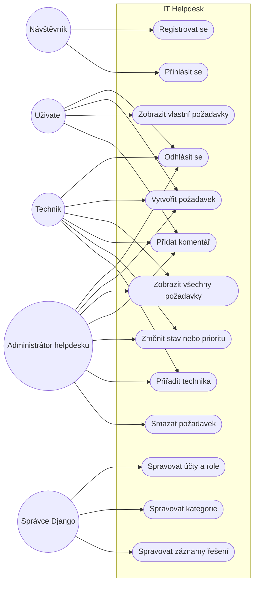
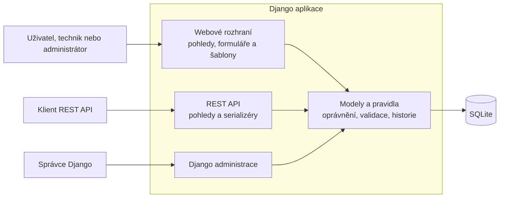
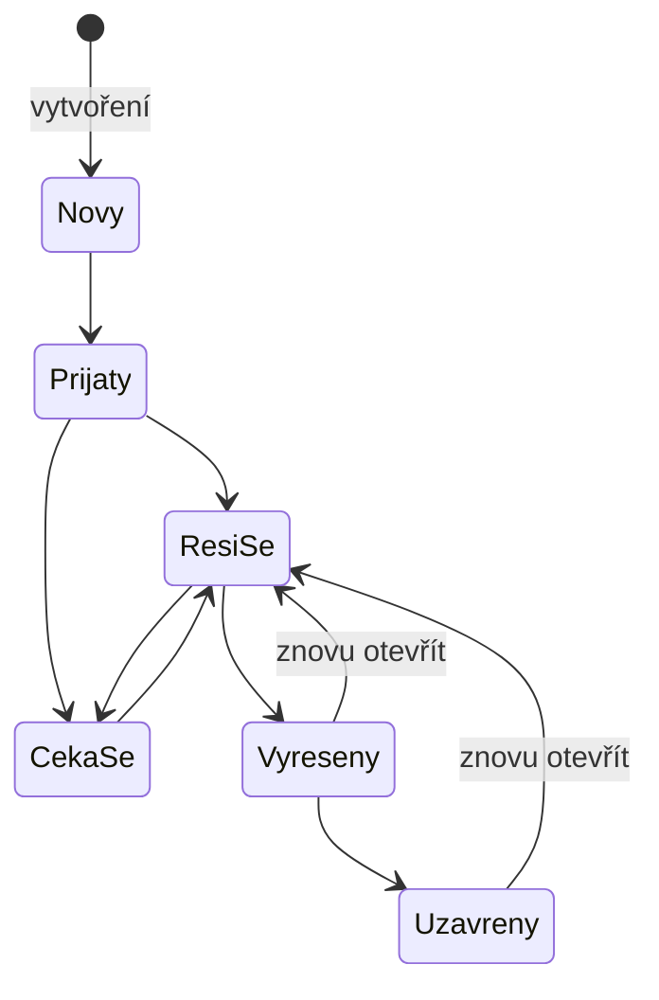

# IT Helpdesk

Webová aplikace pro evidenci a řešení IT požadavků. Projekt je maturitní práce oboru Informační technologie a používá Django, Django REST Framework a SQLite.

## Funkce

- Registrace a přihlášení; nově registrované účty mají roli uživatele.
- Uživatel vidí své požadavky a může přidávat komentáře. Technik vidí všechny požadavky a může měnit jejich stav, prioritu a přiřazení.
- Administrátor může požadavky spravovat a mazat. Aplikační role jsou oddělené od příznaků `is_staff` a `is_superuser` v Django; přístup do administrace určuje `is_staff`. Role se přidělují v administraci Django a veřejná registrace roli technika ani administrátora nenabízí.
- Požadavky lze zařadit do kategorií. Při aplikaci migrací se vytvoří kategorie Hardware, Software, Síť a internet, Účty a přístupy, Tiskárny a periferie a Ostatní; další kategorie lze spravovat v administraci Django.
- Historie změn a komentáře jsou dostupné v detailu požadavku. Záznam řešení lze spravovat v administraci Django.
- Stav požadavku prochází definovaným životním cyklem; vyřešený nebo uzavřený požadavek lze znovu otevřít. Uživatelské účty s navázanými požadavky se deaktivují místo fyzického mazání.
- Přehled požadavků a REST API.

## Spuštění pomocí Dockeru

Je potřeba Docker s Docker Compose.

```bash
docker compose up --build
```

Při startu se automaticky provedou databázové migrace. Aplikace poběží na <http://localhost:8000/>. Databáze SQLite je uložena v pojmenovaném svazku `helpdesk_data`, takže data zůstanou zachována i po zastavení kontejneru.

Migrace také převedou dosavadní účty bez příznaku administrátora na roli uživatele, aby zneužitelná role z dřívější veřejné registrace nezůstala aktivní. Ověřené techniky je potřeba následně znovu nastavit v administraci Django.

Vytvoření administrátorského účtu:

```bash
docker compose exec web python manage.py createsuperuser
```

Zastavení aplikace:

```bash
docker compose down
```

Odstranění databáze a všech uložených dat:

```bash
docker compose down --volumes
```

Docker konfigurace je určena pro lokální vývoj. Django development server nepoužívejte pro veřejné produkční nasazení.

## Spuštění bez Dockeru

Je potřeba Python 3.12 nebo novější.

```bash
python -m venv .venv
source .venv/bin/activate
pip install -r requirements.txt
python manage.py migrate
python manage.py createsuperuser
python manage.py runserver
```

Na Windows aktivujte prostředí příkazem `.venv\Scripts\activate`. Aplikace bude dostupná na <http://127.0.0.1:8000/>.

Při spuštění v jiném prostředí nezapomeňte provést `python manage.py migrate`, aby se vytvořilo aktuální databázové schéma.

## REST API

| Metoda | Cesta | Popis |
| --- | --- | --- |
| `GET`, `POST` | `/api/tickets/` | Seznam a vytvoření požadavků |
| `GET`, `PUT`, `PATCH`, `DELETE` | `/api/tickets/<id>/` | Zobrazení a úprava požadavku |

Administrace Django je dostupná na `/admin/`.

Úpravy přes API odpovídají rolím: běžný uživatel může vytvářet požadavky, ale nemůže měnit jejich stav ani je mazat; mazání je vyhrazené administrátorovi.

## Role a případy užití

Diagram shrnuje hlavní činnosti jednotlivých rolí. Administrátor helpdesku
dědí oprávnění technika. Správce Django je oddělená role: přístup do Django
administrace se řídí příznakem `is_staff`, nikoliv aplikační rolí helpdesku.



## Architektura aplikace

Uživatelé pracují s helpdeskem přes webové rozhraní, přihlášení klienti mohou
využít také REST API a správci Django mají samostatné administrační rozhraní.
Všechny cesty používají společné modely a pravidla aplikace; data se ukládají
do SQLite.



## Životní cyklus požadavku

Stavy a povolené přechody odpovídají validaci v aplikaci. Technik může
požadavek vyřešit nebo jej dát do čekání; vyřešený či uzavřený požadavek lze
znovu otevřít. Při opětovném otevření se smaže čas vyřešení a při dalším
vyřešení se nastaví nový.



## Databázový diagram

Databázové schéma ve formátu DBML pro [dbdiagram.io](https://dbdiagram.io/) je v [docs/database.dbml](docs/database.dbml). Diagram zachycuje aplikační tabulky; interní tabulky Django autentizace, relace, migrací a administrace jsou vynechány.

Datový slovník, kardinality, pravidla životního cyklu, mazání a integritní omezení popisuje [docs/database-design.md](docs/database-design.md).


## Testy

```bash
python manage.py test
```
