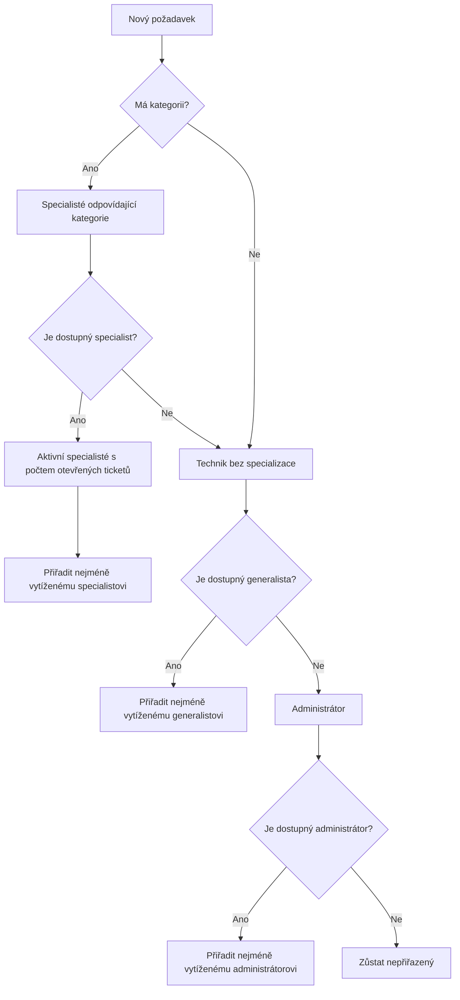
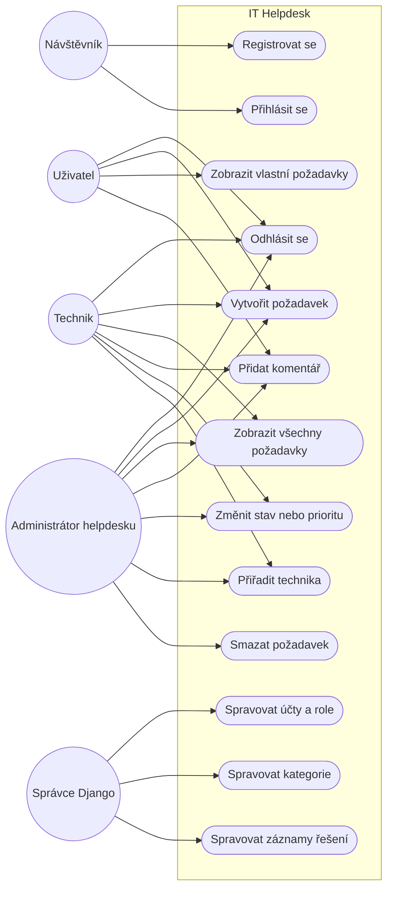
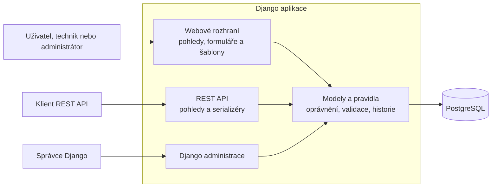
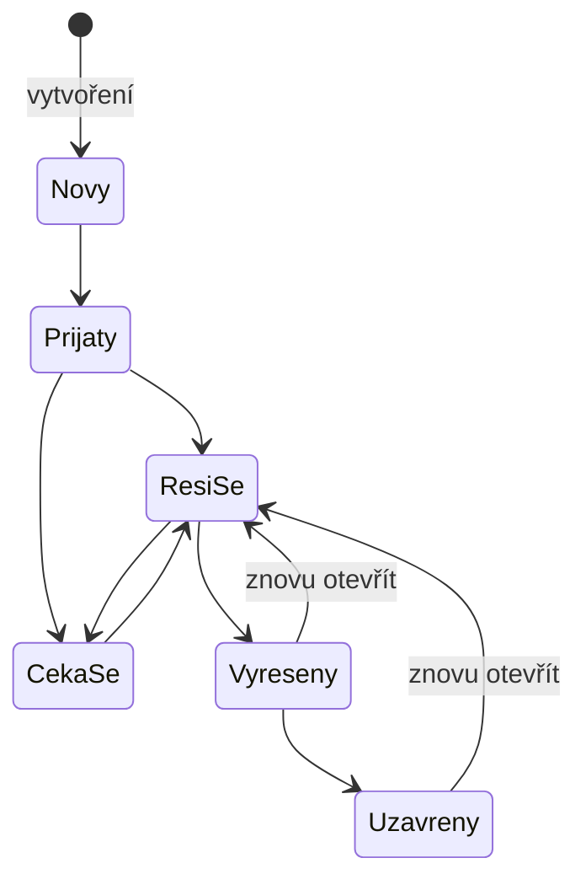

<div align="center">

# IT Helpdesk

**Moderní systém pro evidenci, přiřazování a řešení IT požadavků**

Maturitní projekt | Django | Django REST Framework | SQLite / PostgreSQL

</div>

Webová aplikace pro evidenci a řešení IT požadavků. V projektu jsou oddělené role uživatelů, techniků a administrátorů, kateg­orie ticketů, SLA, historie změn, notifikace a REST API.

## Obsah

- [Klíčové funkce](#klíčové-funkce)
- [Automatické přiřazení](#automatické-přiřazení)
- [Spuštění pomocí Dockeru](#spuštění-pomocí-dockeru)
- [Spuštění bez Dockeru](#spuštění-bez-dockeru)
- [REST API](#rest-api)
- [Role a případy užití](#role-a-případy-užití)
- [Architektura a diagramy](#architektura-aplikace)
- [Testy](#testy)

## Klíčové funkce

- Registrace a přihlášení; nově registrované účty mají roli uživatele.
- Uživatel vidí své požadavky a může přidávat komentáře. Technik vidí všechny požadavky a může měnit jejich stav, prioritu a přiřazení.
- Administrátor může požadavky spravovat a mazat. Aplikační role jsou oddělené od příznaků `is_staff` a `is_superuser` v Django; přístup do administrace určuje `is_staff`. Role se přidělují v administraci Django a veřejná registrace roli technika ani administrátora nenabízí.
- Požadavky lze zařadit do kategorií. Při aplikaci migrací se vytvoří kategorie Hardware, Software, Síť a internet, Účty a přístupy, Tiskárny a periferie a Ostatní; další kategorie lze spravovat v administraci Django.
- Techniky lze v administraci přiřadit k jedné nebo více kategoriím. Nový požadavek se automaticky přiřadí specialistovi dané kategori­e s nejnižším počtem otevřených požadavků. Pokud specialisté ani generalisté nejsou dostupní, přiřazuje se nejvolnější administrátor; jinak požadavek zůstane nepřiřazený.
- Historie změn, veřejné komentáře a interní poznámky techniků jsou dostupné v detailu požadavku. Přílohy lze stáhnout pouze po ověření přístupu k požadavku.
- SLA stanovuje termín první reakce a vyřešení podle priority; dashboard upozorňuje na překročené termíny. Časy se počítají v kalendářních hodinách a při čekání se zatím nepozastavují.
- Uživatelé i technici dostávají aplikační upozornění a e-mail při důležitých událostech. Ve výchozím lokálním nastavení se e-maily vypisují do konzole; SMTP lze nastavit proměnnými prostředí `EMAIL_BACKEND`, `EMAIL_HOST`, `EMAIL_PORT`, `EMAIL_HOST_USER`, `EMAIL_HOST_PASSWORD`, `EMAIL_USE_TLS`, `DEFAULT_FROM_EMAIL` a `SITE_URL`.
- Uživatel může ohodnotit vyřešený požadavek. Znalostní bázi lze spravovat v administraci Django; uživatelé vidí pouze publikované články.
- Seznam požadavků podporuje vyhledávání podle názvu, popisu nebo čísla, filtrování a stránkování.
- Záznam řešení lze spravovat v administraci Django.
- Stav požadavku prochází definovaným životním cyklem; vyřešený nebo uzavřený požadavek lze znovu otevřít. Uživatelské účty s navázanými požadavky se deaktivují místo fyzického mazání.
- Přehled požadavků a REST API.

## Automatické přiřazení

Nový požadavek se přiřazuje automaticky při vytvoření:



Otevřenými se rozumí stavy `Nový`, `Přijatý`, `Řeší se` a `Čeká se`. Při více technicích se rozhoduje podle počtu otevřených ticketů, uživatelského jména a ID, aby bylo přiřazení deterministické.

## Spuštění pomocí Dockeru

Je potřeba Docker s Docker Compose.

```bash
docker compose up --build
```

Při startu se automaticky provedou databázové migrace. Aplikace poběží na <http://localhost:8000/>. PostgreSQL data jsou uložena v pojmenovaném svazku `postgres_data`, takže zůstanou zachována i po zastavení kontejnerů. Výchozí přihlašovací údaje v Compose jsou určeny pouze pro lokální vývoj; pro jiné prostředí je nastavte pomocí proměnných `POSTGRES_DB`, `POSTGRES_USER` a `POSTGRES_PASSWORD`.

Přechod ze SQLite databáze není automatický. Po prvním spuštění PostgreSQL vytvoří migrace nové schéma, ale data ze souboru `db.sqlite3` se nepřenesou.

Migrace také převedou dosavadní účty bez příznaku administrátora na roli uživatele, aby zneužitelná role z dřívější veřejné registrace nezůstala aktivní. Ověřené techniky je potřeba následně znovu nastavit v administraci Django.

Vytvoření administrátorského účtu:

```bash
docker compose exec web python manage.py createsuperuser
```

Zastavení aplikace:

```bash
docker compose down
```

Odstranění databáze a všech uložených dat:

```bash
docker compose down --volumes
```

Docker konfigurace je určena pro lokální vývoj. Django development server nepoužívejte pro veřejné produkční nasazení.
Před nasazením nastavte dlouhý náhodný `SECRET_KEY`, `DEBUG=false` a `ALLOWED_HOSTS` s povolenými názvy domén.
Pro HTTPS lze zapnout `SECURE_SSL_REDIRECT=true`, `SESSION_COOKIE_SECURE=true`, `CSRF_COOKIE_SECURE=true` a volitelně HSTS přes `SECURE_HSTS_SECONDS`, `SECURE_HSTS_INCLUDE_SUBDOMAINS` a `SECURE_HSTS_PRELOAD`. Původní adresy HTTPS proxy nebo reverzní proxy lze uvést v `CSRF_TRUSTED_ORIGINS` oddělené čárkou.

## Spuštění bez Dockeru

Je potřeba Python 3.12 nebo novější. Ve výchozím nastavení se data ukládají do souboru `db.sqlite3` a PostgreSQL není potřeba. Pro použití PostgreSQL nastavte `USE_POSTGRES=1` nebo proměnnou `POSTGRES_HOST`; výchozí připojení pak očekává databázi `helpdesk`, uživatele `helpdesk`, heslo `helpdesk_dev` a server na `localhost:5432`. Hodnoty lze změnit proměnnými prostředí `POSTGRES_DB`, `POSTGRES_USER`, `POSTGRES_PASSWORD`, `POSTGRES_HOST` a `POSTGRES_PORT`.

```bash
python -m venv .venv
source .venv/bin/activate
pip install -r requirements.txt
python manage.py migrate
python manage.py createsuperuser
python manage.py runserver
```

Na Windows aktivujte prostředí příkazem `.venv\Scripts\activate`. Aplikace bude dostupná na <http://127.0.0.1:8000/>.

Při spuštění v jiném prostředí nezapomeňte provést `python manage.py migrate`, aby se vytvořilo aktuální databázové schéma.

## REST API

| Metoda | Cesta | Popis |
| --- | --- | --- |
| `GET`, `POST` | `/api/tickets/` | Seznam a vytvoření požadavků |
| `GET`, `PUT`, `PATCH`, `DELETE` | `/api/tickets/<id>/` | Zobrazení a úprava požadavku |

Administrace Django je dostupná na `/admin/`. Články znalostní báze a záznamy řešení se spravují právě tam.

Přílohy jsou omezené na 5 MB a typy PDF, JPG, PNG a TXT. V Docker Compose se soubory uchovávají v pojmenovaném svazku `helpdesk_media`.

Úpravy přes API odpovídají rolím: běžný uživatel může vytvářet požadavky s normální prioritou, ale nemůže měnit jejich stav, prioritu ani je mazat; mazání je vyhrazené administrátorovi.

## Role a případy užití

Diagram shrnuje hlavní činnosti jednotlivých rolí. Administrátor helpdesku
dědí oprávnění technika. Správce Django je oddělená role: přístup do Django
administrace se řídí příznakem `is_staff`, nikoliv aplikační rolí helpdesku.



## Architektura aplikace

Uživatelé pracují s helpdeskem přes webové rozhraní, přihlášení klienti mohou
využít také REST API a správci Django mají samostatné administrační rozhraní.
Všechny cesty používají společné modely a pravidla aplikace; data se ukládají
do PostgreSQL.



## Životní cyklus požadavku

Stavy a povolené přechody odpovídají validaci v aplikaci. Technik může
požadavek vyřešit nebo jej dát do čekání; vyřešený či uzavřený požadavek lze
znovu otevřít. Při opětovném otevření se smaže čas vyřešení a při dalším
vyřešení se nastaví nový.



## Databázový diagram

Databázové schéma ve formátu DBML pro [dbdiagram.io](https://dbdiagram.io/) je v [docs/database.dbml](docs/database.dbml). Diagram zachycuje aplikační tabulky; interní tabulky Django autentizace, relace, migrací a administrace jsou vynechány.

Datový slovník, kardinality, pravidla životního cyklu, mazání a integritní omezení popisuje [docs/database-design.md](docs/database-design.md).

## Testy

```bash
python manage.py test
```
